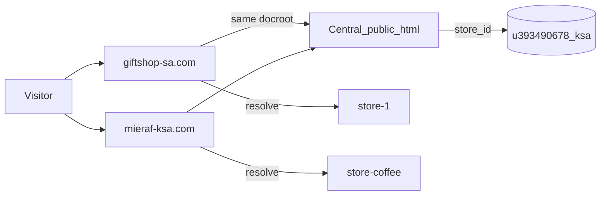

# Flowers → Central Hostinger Migration

> **SUPERSEDED (owner 2026-11-26):** Flowers **alag Hostinger pe same rahe**. Cutover / DNS merge to central **mat karo** jab tak owner explicit na kahe.  
> **Policy:** `store-1` = dedicated flowers account · Coffee + Bleco + **har naya store** = central (`mieraf-ksa.com`) hosting + domain/subdomain.  
> Code lock: `App\Support\HostingerCloud` · `ProvisionNewStoreService` · `docs/38`.

**Legacy goal (optional only if owner re-opens):** `giftshop-sa.com` (`store-1`) alag Hostinger se **central** pe lao.  
**URL same rahe:** `https://giftshop-sa.com`  
**DB target (legacy):** shared central MySQL `u393490678_ksa` + `store_id` isolation (Approach A).

---

## Live snapshot (2026-11-25 22:53 AST re-probe)

| Check | Result |
|-------|--------|
| Central `GET /api/health` | **200** · `active_live_mysql` · DB `u393490678_ksa` · 3 stores |
| Central resolve `giftshop-sa.com` | **200** · `store_id=store-1` · theme `theme-flora-luxe` |
| Central products `store_id=store-1` | **200** · products OK (39 in resolve meta) |
| Flowers `GET /api/health` | **503** · `mysql_required_unavailable` (wrong host / broken DB) |
| DNS `giftshop-sa.com` A | `193.58.105.18` / `77.37.50.6` (**alag** — cutover baqi) |
| DNS `mieraf-ksa.com` A | `147.79.116.167` / `147.79.119.151` (**central target**) |

**Matlab:** Commerce data `store-1` **pehle se central MySQL mein hai**. Asli gap = `giftshop-sa.com` abhi **central ke current IPs pe nahi** — is liye API 503.

---

## Ownership

| Who | What |
|-----|------|
| **Agent (done / ready)** | Probe, confirm central has `store-1`, Master bounce rules, verify script, this runbook, docs notes |
| **You (Hostinger + DNS)** | Addon domain, DNS A/CNAME, SSL, cutover confirm, old account freeze |
| **Agent (after you ask deploy)** | Final central deploy if needed + post-cutover smoke |

**Agent cannot:** Hostinger hPanel login, add addon domain, edit DNS, issue SSL, cancel old plan.

---

## Architecture after cutover



- One upload (`deploy:central` / `deploy:fast:central`) updates coffee + flowers + bleco.
- `/master*` on `giftshop-sa.com` still redirects to `https://mieraf-ksa.com/master/login` ([public/.htaccess](../public/.htaccess)).

---

## YOUR STEPS (full — Hostinger panel)

Do these in order. Estimated downtime: DNS TTL (often 5–60 min). Prefer low-traffic window.

### Step 1 — Central Hostinger: add domain

1. Login **central** Hostinger hPanel (account that owns `mieraf-ksa.com` / FTP user `u393490678…`).
2. **Domains** → **Add website / Addon domain** → enter `giftshop-sa.com`.
3. Point it to the **same document root** as `mieraf-ksa.com` (`public_html`).  
   Do **not** create a second separate website folder if you want one-upload multi-store.
4. Also add `www.giftshop-sa.com` (alias / www redirect to apex).

### Step 2 — SSL

1. In central hPanel → SSL for `giftshop-sa.com` (+ www).
2. Wait until status **Active** (Let’s Encrypt / Hostinger SSL).
3. Force HTTPS if the panel offers it.

### Step 3 — DNS cutover for `giftshop-sa.com`

Current A records point to the **old** flowers IPs (`147.79…`). Change them to **central** IPs (same as `mieraf-ksa.com`):

| Type | Host | Value (**same as live `mieraf-ksa.com` — re-check if Hostinger rotates**) |
|------|------|----------------------------------------------------------|
| A | `@` | `147.79.116.167` |
| A | `@` | `147.79.119.151` |
| CNAME or A | `www` | follow Hostinger “www” recommendation for the addon (or CNAME → `giftshop-sa.com`) |

**Do not** point giftshop at `193.58…` / `77.37…` — woh ab giftshop ke stale A records hain (503 host), central nahi.

**Where to edit DNS:**

- Domain NS is `*.dns-parking.com` → edit DNS in the **Hostinger DNS zone** that controls giftshop (often the **old** flowers hPanel DNS, or Domains → DNS).
- Alternative (cleaner long-term): in central hPanel, use **Connect domain** / change nameservers to the nameservers Hostinger shows for the central site, then manage all DNS from central.

**Before save:** screenshot old A records (rollback).

### Step 4 — Propagation wait

1. Wait 5–60 minutes (sometimes up to 24h).
2. From your PC check:

```powershell
Resolve-DnsName giftshop-sa.com -Type A
```

Expected: same IPs as `mieraf-ksa.com` (central), **not** `147.79…`.

### Step 5 — Smoke (must all pass)

```powershell
Invoke-WebRequest https://giftshop-sa.com/api/health -UseBasicParsing
Invoke-WebRequest "https://giftshop-sa.com/api/storefront/resolve-domain?domain=giftshop-sa.com" -UseBasicParsing
Invoke-WebRequest "https://giftshop-sa.com/api/products?store_id=store-1&per_page=1" -UseBasicParsing
```

Pass criteria:

1. `/api/health` → **200** + `active_live_mysql` + `db_name` = `u393490678_ksa` (central DB)
2. resolve-domain → `store_id` = `store-1`
3. products → real rows (not empty if catalog has data)
4. Open `https://giftshop-sa.com/admin` → login page (not bounce to broken API)
5. Open `https://giftshop-sa.com/master` → must redirect to `https://mieraf-ksa.com/master/login`
6. Coffee still OK: `https://mieraf-ksa.com/api/health` → 200

Or run locally:

```bash
node scripts/verify-flowers-central-migration.js
```

### Step 6 — After green smoke: freeze old flowers Hostinger

1. Do **not** delete the old account for 7–14 days (rollback safety).
2. In **old** flowers hPanel: pause site / leave files, but stop writing new orders there (DNS already elsewhere).
3. Optional: download a full backup ZIP from old hPanel once more.
4. After 7–14 days stable: cancel old Hostinger plan / remove old site.

### Step 7 — Tell agent (chat)

Message example:

> DNS cutover done. Run smoke + update deploy scripts. Deploy central if needed: `deploy:fast:central`

Then agent will:

- Re-run verify script
- Flip docs/AGENTS to “flowers = central”
- Soft-deprecate `deploy:flowers` dual FTP (keep credentials temporarily)
- Set `store-1` `hosting_mode=shared` / `db_isolation=shared_store_id` if still marked dedicated

---

## Agent checklist (already done / prep)

- [x] Confirmed central DB already serves `store-1` (39 products)
- [x] Confirmed resolve `giftshop-sa.com` → `store-1` on central API
- [x] Confirmed Master bounce rule for giftshop host in `.htaccess`
- [x] Documented DNS IP delta (old vs central)
- [x] Verify script: `scripts/verify-flowers-central-migration.js`
- [ ] Post-cutover: deprecate dual deploy + docs lock (after your Step 5–7)

---

## Rollback (if cutover fails)

1. Put giftshop A records back to old IPs: `147.79.119.118` / `147.79.116.179`
2. Wait DNS
3. Note: old flowers **API was 503** at probe time — rollback may restore HTML only; fix old MySQL password or finish central cutover instead.

---

## Do not

- Create a second full Laravel copy under a separate giftshop folder on central (splits deploys again)
- Point giftshop to central without SSL
- Cancel old Hostinger before Step 5 smoke is green
- Serve Master Admin UI on giftshop (must stay central-only)
- Deploy from agent without your explicit `deploy` ask
