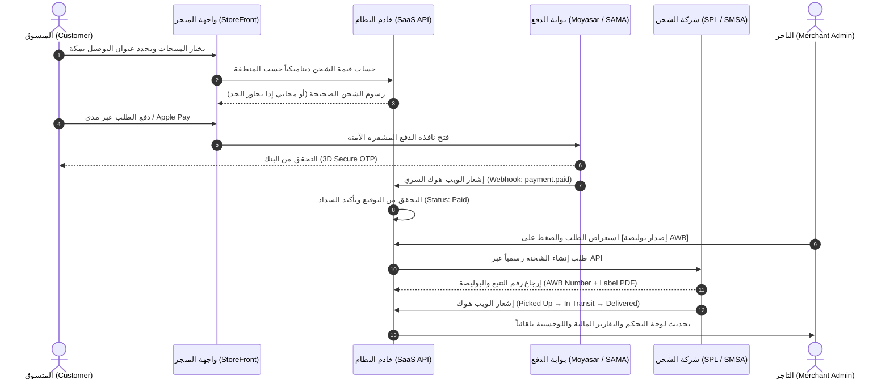

# 📦 Real Shipping, Courier & Payment Integration Guide
# دليل الربط والتكامل الميداني للشحن وشركات النقل وبوابات الدفع الإلكتروني

---

## 🌐 Overview / نظرة عامة
This document details the multi-store isolated architecture for **Shipping Methods**, **Saudi Shipping Zones**, **Official Courier APIs (SPL, SMSA, Aramex, DHL, FedEx, UPS)**, and **Certified Payment Gateways (Moyasar, Tap, HyperPay, Stripe, PayPal, COD)**. All operational data is stored in store-scoped database tables and processed through official RESTful APIs and HMAC-verified webhooks.

هذا الدليل يوضح البنية التحتية لعزل المتاجر المتعددة الخاصة بـ **طرق الشحن**، **المناطق والمدن السعودية**، **واجهات شركات الشحن الرسمية (سبل، سمسا، أرامكس، دي إتش إل، فيديكس، يو بي إس)**، و**بوابات الدفع الإلكتروني المعتمدة (ميسر، تاب، هايبرباي، سترايب، باي بال، الدفع عند الاستلام)**.

---

## 1. 🚚 Shipping Methods / طرق الشحن

### Supported Configurable Methods / طرق الشحن المدعومة:
1. **Free Shipping (شحن مجاني)**: Order value threshold trigger (`freeShippingThreshold`).
2. **Flat Rate (سعر موحد)**: Fixed delivery price across designated regions.
3. **Area / Zone Based (حسب المناطق والمدن)**: Linked directly to Saudi provinces/cities matrix.
4. **Weight Based (حسب الوزن)**: Computes `baseRate + (weightKg * perKgRate)`.
5. **Order Value Based (حسب قيمة الطلب)**: Tiered rates based on cart total.
6. **Same-Day Delivery (توصيل فوري بنفس اليوم)**: Express expedited delivery for central zones.
7. **Scheduled Delivery (توصيل مجدول)**: Customer selects date/time delivery slot.
8. **Local Pickup (استلام من الفرع / المتجر)**: Free in-store fulfillment.
9. **Cash on Delivery (الدفع عند الاستلام - COD)**: Allows physical cash settlement upon handover with optional COD service surcharge.

### How to Create a Shipping Method / طريقة إنشاء طريقة شحن:
1. Navigate to **Store Admin → Shipping (الشحن)**.
2. Click **Add Shipping Method (+ إضافة طريقة شحن)**.
3. Fill in the parameters:
   - **Method Name (English & Arabic)**: e.g. `Same-Day Express Delivery` / `التوصيل الفوري بنفس اليوم`.
   - **Calculation Type**: Select from Flat Rate, Free, Weight Based, Zone Based, etc.
   - **Base Fee (SAR)**: e.g. `25 SAR`.
   - **Free Shipping Threshold**: e.g. `250 SAR` (if order exceeds 250 SAR, fee drops to 0).
   - **Estimated Delivery (ETA)**: e.g. `Within 2 Hours` / `خلال ساعتين`.
   - **COD Availability**: Toggle whether Cash on Delivery is permissible for this method.
4. Click **Save Method**. The method is instantly persisted to the store-isolated `shipping_methods` table.

---

## 2. 🗺️ Shipping Zones Matrix / مصفوفة مناطق الشحن

### Structure / الهيكلية:
- **Kingdom of Saudi Arabia (المملكة العربية السعودية)**:
  - **Makkah Region (منطقة مكة المكرمة)**: Makkah Haram & Hotels, Central Area, Aziziyah, Jabal Omar, Jeddah, Taif.
  - **Riyadh Region (منطقة الرياض)**: Olaya, Malaz, King Fahd Road, Diriyah, Kharj.
  - **Eastern Province (المنطقة الشرقية)**: Dammam, Khobar, Dhahran, Jubail, Al Ahsa.
  - **Madinah Region (منطقة المدينة المنورة)**: Central Haram, Quba, Yanbu.
  - **Asir & Southern Region (منطقة عسير والجنوب)**: Abha, Khamis Mushait, Jazan.
  - **Other Regions (باقي المناطق)**: Tabuk, Hail, Al Jouf, Northern Borders.

### How to Add / Edit a Shipping Zone:
1. Under **Store Admin → Shipping**, select the **Saudi Shipping Zones & Rates** tab.
2. Click **Add City / Zone (+ إضافة مدينة / منطقة)**.
3. Input City Name, Select Province, Base Delivery Fee (SAR), and ETA.
4. Click **Save City**. Checkout dynamically calculates rates matching the customer address.

---

## 3. 🏢 Official Courier Connections / ربط شركات الشحن الرسمية

### Supported Official Providers / الشركات المعتمدة:
- **Saudi Post (SPL | سبل البريد السعودي)**: National Address verification, Wasel integration, domestic parcel dispatch.
- **SMSA Express (سمسا إكسبريس)**: Domestic express door-to-door, COD collection, automated AWB generation.
- **Aramex (أرامكس)**: Regional & International express shipping, real-time GPS tracking.
- **DHL Express**: Worldwide international delivery with automated customs clearance.
- **FedEx Express**: Priority air express courier.
- **UPS**: Global logistics network.

### Courier Connection Flow / خطوات ربط شركة الشحن:
```
1. Select Courier Provider (SPL, SMSA, Aramex, DHL, FedEx, UPS)
       │
       ▼
2. Enter Official API Credentials (Account Number, API Key, API Secret, Sandbox Mode)
       │
       ▼
3. Click [Test API Connection] → Backend pings courier service
       │
       ▼
4. Status verified: "Connected ✓" (Credentials saved encrypted server-side)
       │
       ▼
5. Click [Sync Rates] → Sync official service codes and operational zones
```

### How to Dispatch Shipment & Generate AWB / طريقة إصدار بوليصة الشحن (AWB):
1. Navigate to **Store Admin → Orders (الطلبات)**.
2. Select any order in `processing` or `awaiting dispatch` status.
3. In the Order Detail sidebar under **Shipping Info**, click **Dispatch / Create AWB (إصدار بوليصة AWB)**.
4. The system sends a server-side request to the courier API:
   - Registers package weight, dimensions, and customer address.
   - Generates official **AWB Number** (Air Waybill) and **Tracking Number**.
   - Generates printable PDF shipping label (`labelUrl`).
5. Order tracking number is updated automatically, and courier webhook tracks transit states.

---

## 4. 💳 Certified Payment Gateways / بوابات الدفع الإلكتروني

### Supported Providers:
- **Moyasar (ميسر)**: SAMA licensed. Supports **Mada (مدى)**, **Apple Pay**, **STC Pay**, **Visa / Mastercard**.
- **Tap Payments (تاب)**: GCC & MENA payment infrastructure.
- **HyperPay (هايبرباي)**: Enterprise Saudi payment gateway.
- **Stripe Global**: Worldwide card processing & Apple Pay.
- **PayPal**: International wallet.
- **Cash on Delivery (الدفع عند الاستلام)**: Zero online fee, cash reconciliation on delivery.

### Gateway Connection Flow:
1. In **Store Admin → Payments (المدفوعات)**, locate **Certified Official Payment Gateways**.
2. Click **Configure / Connect** on the desired gateway (e.g. Moyasar).
3. Input:
   - **Publishable Key**: `pk_live_...` (or test key in sandbox mode).
   - **Secret Key**: `sk_live_...` (encrypted on backend, never exposed in client bundle).
   - **Transaction Fee %**: Store-level merchant fee rate.
   - **Sandbox Mode**: Toggle on for testing without real fund transfers.
4. Click **Test Connection** → Backend executes server-side ping test against provider API.
5. Click **Save & Enable**.

---

## 5. 🔄 End-to-End Operational Flow / دورة الطلب والدفع والشحن



---

## 6. 🛡️ Server-Side Webhooks & Security / الويب هوك والأمان

### Payment Webhooks:
- Inbound endpoint: `POST /api/webhooks/payment/{provider}`
- Verified using HMAC-SHA256 signature verification matching provider secret.
- **Never trusts client frontend status**: An order is only set to `Paid` upon cryptographically verified gateway payload.
- Automatically handles: `paid`, `authorized`, `failed`, `refunded`.

### Courier Webhooks:
- Inbound endpoint: `POST /api/webhooks/courier/{provider}`
- Tracks transit progression:
  - `picked_up` → Order shipping status updated to `In Transit`.
  - `out_for_delivery` → Customer receives dispatch SMS alert.
  - `delivered` → Order shipping status updated to `Delivered`.
  - `failed` / `returned` → Merchant notified for return inspection.

---

## 7. 🏪 Strict Tenant Isolation / العزل الصارم بين المتاجر
- Every query is strictly constrained by `store_id`.
- Store A cannot access, view, or modify Store B's:
  - API keys or secrets
  - Courier credentials or shipments
  - Bank IBAN accounts
  - Payment transactions or revenue reports
- Multi-tenant SQLite / MySQL indexes enforce composite uniqueness on `[store_id, provider]`.

---

## 8. 💸 Refunds Handling / استرجاع المدفوعات
1. In **Store Admin → Payments**, scroll to **Recent Payment Transactions**.
2. Locate the transaction and click **Refund (استرجاع)**.
3. System verifies server-side session, calls gateway refund API endpoint, updates transaction status to `Refunded`, and adjusts net store revenue reporting.
